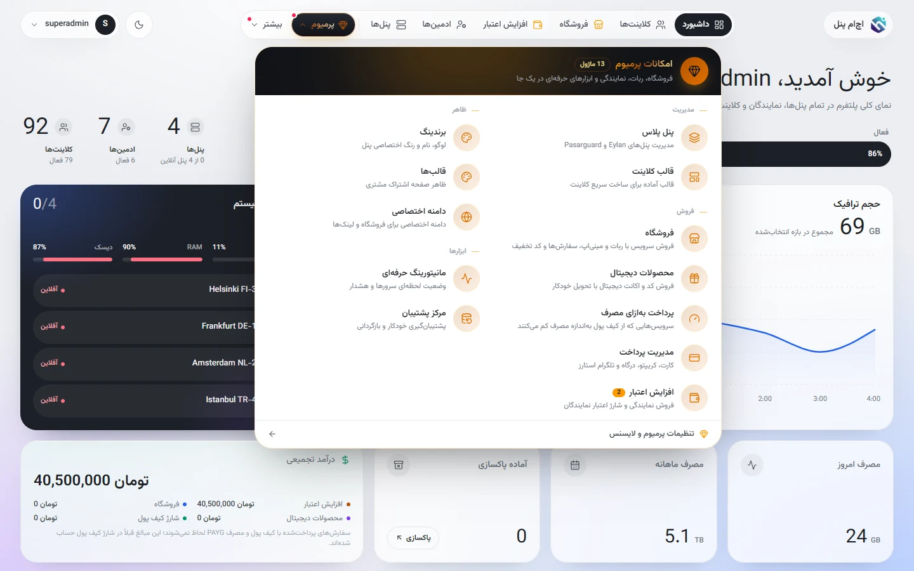
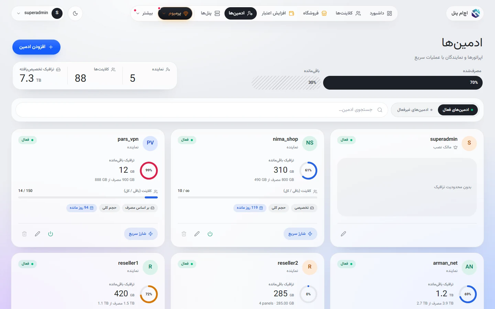
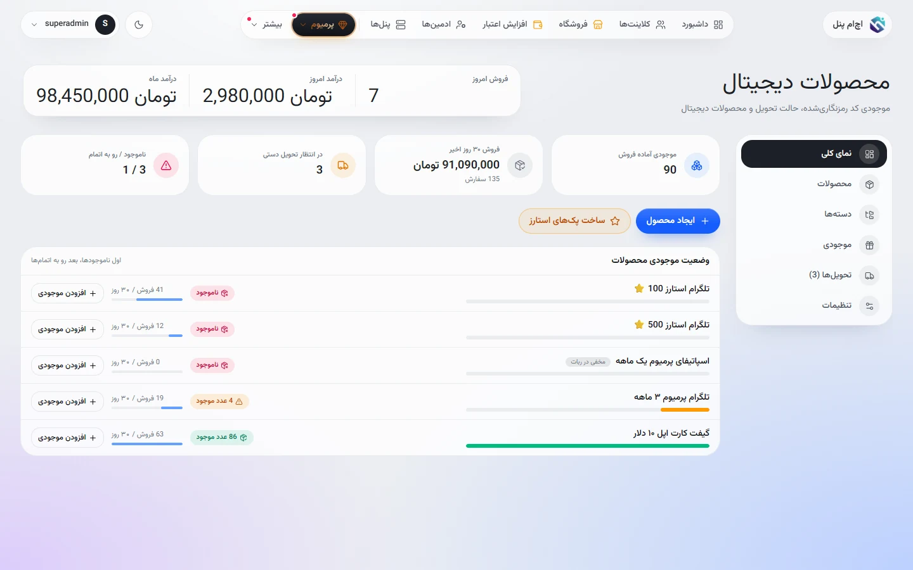
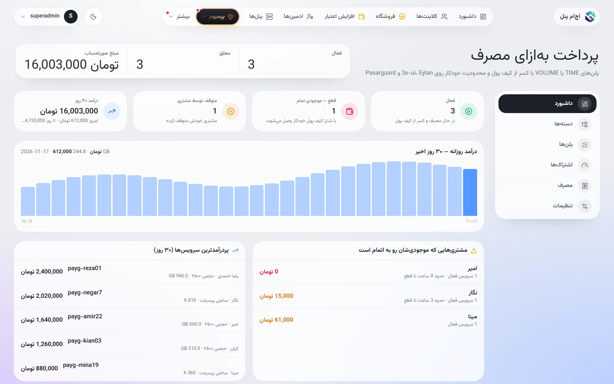
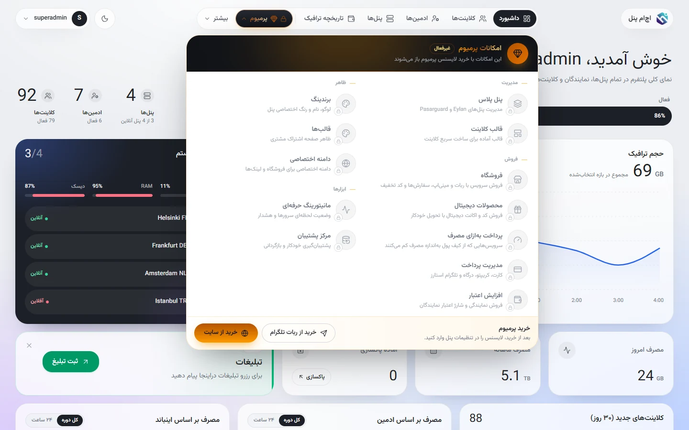
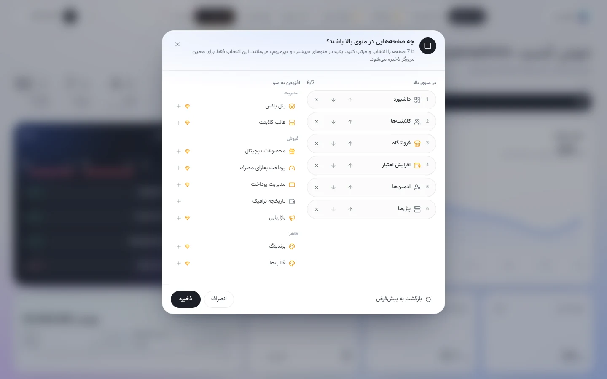

<div align="center">

# HMPanel
**Advanced 3x-ui Management Platform**

[](https://github.com/neoauroraproject/hmpanel/releases/latest)


[English](#english) | [فارسی](#فارسی)

**Docs:** [neoauroraproject.github.io/hmpanel](https://neoauroraproject.github.io/hmpanel/) · **Channel:** [t.me/hmpanel](https://t.me/hmpanel) · **Premium:** [license.hmray.pro](https://license.hmray.pro) · [@neolicensebot](https://t.me/neolicensebot)


</div>

---

<h2 id="english">🇬🇧 English</h2>

HMPanel is a **professional management layer built on top of native 3x-ui**, for VPN providers, resellers and administrators who run many servers and a large number of clients.

### ✨ What's new in v3

- **New modern look, optional.** Dashboard, clients, admins, panels, traffic and every Premium page have new layouts and charts. Top bar or sidebar navigation, light and dark. The classic look is still the default and can be switched back at any time (*Settings → Appearance*, or from the account menu).
- **Your own top menu.** Pick which pages (up to 7) sit in the top bar and in what order (*account menu → Customize top menu*).
- **Dedicated Premium menu.** A gold Premium button opens a mega menu of every Premium module. Without a license the modules are shown locked, with links to buy.
- **Admins:** step-by-step admin creation (shared or per-panel traffic is chosen first), a quick top-up dialog for per-panel GB, client capacity and days, and Premium module access set on the Admins page.
- **Store and Telegram bot (Premium):** one admin message per order (no more duplicates), coupon shown on orders, a redesigned coupon manager, clearer prices and back buttons in the bot, order search and quick settings for admins.
- **Digital goods (Premium):** stock and sales overview, low-stock alerts, and bulk creation of Telegram Stars packs from the price of 100 stars.
- **Pay as you go (Premium):** new dashboard, customers can delete their own service from the bot (it is removed from the panel too), an empty wallet only disables the service.
- **Reseller sales (Premium):** a setup checklist and offer preview, and fixes for per-panel reseller top-ups.
- **Clean uninstall:** removing the panel now deletes everything it installed, so a reinstall works without errors.

Full list: [CHANGELOG.md](CHANGELOG.md).

### 📸 Screenshots

<table>
  <tr>
    <td width="50%" align="center"><br><sub><b>Premium menu</b></sub></td>
    <td width="50%" align="center"><br><sub><b>Clients</b></sub></td>
  </tr>
  <tr>
    <td width="50%" align="center"><br><sub><b>Admins</b></sub></td>
    <td width="50%" align="center"><br><sub><b>Digital goods</b></sub></td>
  </tr>
  <tr>
    <td width="50%" align="center"><br><sub><b>Pay as you go</b></sub></td>
    <td width="50%" align="center"><br><sub><b>Dark mode</b></sub></td>
  </tr>
  <tr>
    <td width="50%" align="center"><br><sub><b>Premium preview without a license</b></sub></td>
    <td width="50%" align="center"><br><sub><b>Customize the top menu</b></sub></td>
  </tr>
</table>

### ⚡ Features

**Community (free)**
- **Multi-panel & reseller management:** control many 3x-ui nodes, resellers with their own traffic, client and expiry limits, shared or per-panel traffic.
- **Traffic accounting:** real-time collection, usage-based and allocation-based modes, grace periods and an audited refund log.
- **Native 3x-ui integration:** clients map to native 3x-ui groups; one client can sit on several inbounds. Supports 3x-ui up to 3.11.
- **Bulk operations & migration:** bulk create, edit, extend and delete; migration from older panels.
- **Backups:** download, upload and restore PostgreSQL backups from the web UI or the `hm` CLI.
- **Modern or classic UI**, Persian and English, light and dark, installable as an app (PWA).

**Premium**
- **Store & Telegram bot:** sell plans with a bot and mini app, receipts, coupons, loyalty, referrals and auto delivery.
- **Digital goods** with encrypted code stock and automatic or manual delivery; **pay-as-you-go** services billed from the customer wallet.
- **Payments:** bank cards, crypto wallets, online gateways and Telegram Stars.
- **Reseller sales:** sell reseller accounts and reseller top-ups end to end.
- **Panel Plus** (Eylan, Pasarguard), client templates, marketing campaigns, branding, themes, custom domains, monitoring and a backup center.

Buy Premium: [license.hmray.pro](https://license.hmray.pro) or [@neolicensebot](https://t.me/neolicensebot). Enter the license in *Settings → Premium License*.

### 🚀 Installation

Run on a fresh Ubuntu (24.04+) or Debian server:
```bash
bash <(curl -fsSL https://raw.githubusercontent.com/neoauroraproject/hmpanel/main/install.sh)
```
*(Requires: direct public IP for Let's Encrypt SSL, 1 GB RAM, 5 GB disk)*

### 🔄 Update

Existing installs update in place; no reinstall is needed and data is kept:
```bash
sudo hm update
```
Or open `sudo hm` and choose **Update**. After updating the panel, press **Update premium bundle** in *Settings → Premium License*.

### 💾 Backup & Restore
- **Web UI:** *Settings → System Maintenance* to download, upload or restore backups with one click.
- **CLI:** run `sudo hm` and choose the backup options.

### 🗑️ Uninstall

Run `sudo hm` and choose **Uninstall**, or call the script directly:
```bash
sudo bash /opt/hmpanel/uninstall.sh --standard   # remove the app, keep database, uploads, backups and .env
sudo bash /opt/hmpanel/uninstall.sh --complete   # remove everything (asks you to type DELETE)
```
Both remove the containers, the systemd service, the `hm` command and leftover temp files, so a later reinstall starts clean. After a standard uninstall, run the installer again to come back with your data, then re-activate Premium.

### 🔑 Reset Main Admin Password
Forgot the owner / SUPER_ADMIN password? Reset it from the server (interactive prompt):
```bash
bash <(curl -fsSL https://raw.githubusercontent.com/neoauroraproject/hmpanel/main/scripts/reset-admin-password.sh)
```
Or via CLI after install/update: `sudo hm admin reset-password` · `sudo hm passwd` · menu option **13**.

Forgot the owner **username** too? `sudo hm admin reset-login` (or `sudo hm reset-login`, menu option **14**) shows the current owner username, then lets you change the username, the password, or both (press Enter to keep either one). The password is typed hidden and asked twice (min 8 characters); a username another admin already uses is rejected, and all existing sessions of the owner are signed out. Run `sudo hm help` for the full command list.

---

<h2 id="فارسی">🇮🇷 فارسی</h2>

<div dir="rtl">

اچ‌ام‌پنل (HMPanel) یک **لایه مدیریت حرفه‌ای روی 3x-ui اصلی** است، برای ارائه‌دهندگان VPN، نماینده‌ها و ادمین‌هایی که چندین سرور و تعداد زیادی کاربر دارند.

### ✨ تازه‌های نسخه ۳

- **ظاهر مدرن جدید (اختیاری).** داشبورد، کلاینت‌ها، ادمین‌ها، پنل‌ها، ترافیک و همه صفحه‌های پرمیوم چیدمان و نمودارهای تازه دارند. منوی بالا یا کناری، روشن و تاریک. ظاهر کلاسیک همچنان پیش‌فرض است و هر وقت بخواهید برمی‌گردد (*تنظیمات ← ظاهر* یا از منوی حساب).
- **منوی بالای شخصی.** انتخاب کنید کدام صفحه‌ها (تا ۷ تا) و به چه ترتیبی در منوی بالا باشند (*منوی حساب ← شخصی‌سازی منوی بالا*).
- **منوی جدای پرمیوم.** دکمه طلایی «پرمیوم» مگامنوی همه ماژول‌های پرمیوم را باز می‌کند. بدون لایسنس، ماژول‌ها قفل‌شده نمایش داده می‌شوند و لینک خرید دارند.
- **ادمین‌ها:** ساخت ادمین مرحله‌به‌مرحله (نوع حجم کلی یا جدا برای هر پنل همان اول)، پنجره شارژ سریع برای حجم هر پنل، ظرفیت کاربر و روز، و تنظیم دسترسی ماژول‌های پرمیوم از همان صفحه ادمین‌ها.
- **فروشگاه و ربات تلگرام (پرمیوم):** فقط یک پیام برای هر سفارش (بدون تکرار)، نمایش کد تخفیف روی سفارش، مدیریت جدید کدهای تخفیف، قیمت واضح‌تر و دکمه بازگشت در ربات، جستجوی سفارش و تنظیمات سریع برای ادمین.
- **محصولات دیجیتال (پرمیوم):** نمای کلی موجودی و فروش، هشدار کمبود موجودی و ساخت گروهی پک‌های تلگرام استارز از روی قیمت ۱۰۰ استارز.
- **پرداخت به‌ازای مصرف (پرمیوم):** داشبورد جدید؛ مشتری می‌تواند سرویسش را از ربات حذف کند (از پنل هم پاک می‌شود)؛ با تمام شدن موجودی سرویس فقط غیرفعال می‌شود.
- **فروش نمایندگی (پرمیوم):** چک‌لیست راه‌اندازی و پیش‌نمایش پیشنهاد، و رفع مشکل شارژ نمایندگان با حجم جدا برای هر پنل.
- **حذف کامل و تمیز:** حذف پنل حالا همه چیزهایی که نصب کرده را پاک می‌کند و نصب دوباره بدون خطا انجام می‌شود.

فهرست کامل: [CHANGELOG.md](CHANGELOG.md)

### 📸 تصاویر

<table>
  <tr>
    <td width="50%" align="center"><br><sub><b>منوی پرمیوم</b></sub></td>
    <td width="50%" align="center"><br><sub><b>کلاینت‌ها</b></sub></td>
  </tr>
  <tr>
    <td width="50%" align="center"><br><sub><b>ادمین‌ها</b></sub></td>
    <td width="50%" align="center"><br><sub><b>محصولات دیجیتال</b></sub></td>
  </tr>
  <tr>
    <td width="50%" align="center"><br><sub><b>پرداخت به‌ازای مصرف</b></sub></td>
    <td width="50%" align="center"><br><sub><b>حالت تاریک</b></sub></td>
  </tr>
  <tr>
    <td width="50%" align="center"><br><sub><b>پیش‌نمایش پرمیوم بدون لایسنس</b></sub></td>
    <td width="50%" align="center"><br><sub><b>شخصی‌سازی منوی بالا</b></sub></td>
  </tr>
</table>

### ⚡ امکانات

**نسخه رایگان (Community)**
- **مدیریت چند پنل و نماینده:** کنترل چندین سرور 3x-ui، نماینده‌ها با محدودیت حجم، تعداد کاربر و زمان؛ حجم کلی یا جدا برای هر پنل.
- **حسابداری ترافیک:** محاسبه لحظه‌ای، حالت مصرفی و تخصیصی، مهلت قطع و لاگ امن استرداد.
- **یکپارچگی با 3x-ui:** اتصال کلاینت‌ها به گروه‌های اصلی 3x-ui و یک کلاینت روی چند اینباند. پشتیبانی تا نسخه 3.11.
- **عملیات گروهی و مهاجرت:** ساخت، ویرایش، تمدید و حذف گروهی؛ مهاجرت از پنل‌های قدیمی.
- **پشتیبان‌گیری:** دانلود، آپلود و بازگردانی بکاپ از پنل یا دستور `hm`.
- **ظاهر مدرن یا کلاسیک**، فارسی و انگلیسی، روشن و تاریک، قابل نصب به‌صورت اپ (PWA).

**نسخه پرمیوم**
- **فروشگاه و ربات تلگرام:** فروش پلن با ربات و مینی‌اپ، رسید، کد تخفیف، باشگاه مشتریان، دعوت دوستان و تحویل خودکار.
- **محصولات دیجیتال** با موجودی کد رمزگذاری‌شده و تحویل خودکار یا دستی؛ **پرداخت به‌ازای مصرف** از کیف پول مشتری.
- **پرداخت:** کارت بانکی، کیف پول کریپتو، درگاه آنلاین و تلگرام استارز.
- **فروش نمایندگی:** فروش حساب نمایندگی و شارژ نمایندگان از اول تا آخر.
- **پنل پلاس** (Eylan و Pasarguard)، قالب کلاینت، کمپین بازاریابی، برندینگ، قالب صفحه اشتراک، دامنه اختصاصی، مانیتورینگ و مرکز پشتیبان.

خرید پرمیوم: [license.hmray.pro](https://license.hmray.pro) یا ربات [@neolicensebot](https://t.me/neolicensebot). لایسنس را در *تنظیمات ← لایسنس پرمیوم* وارد کنید.

### 🚀 نصب

دستور زیر را در یک سرور اوبونتو (24.04+) یا دبیان تازه وارد کنید:

</div>

```bash
bash <(curl -fsSL https://raw.githubusercontent.com/neoauroraproject/hmpanel/main/install.sh)
```

<div dir="rtl">

*(پیش‌نیازها: آی‌پی پابلیک مستقیم برای SSL، حداقل ۱ گیگ رم و ۵ گیگ فضا)*

### 🔄 به‌روزرسانی

نصب‌های قبلی بدون نصب دوباره و بدون از دست رفتن اطلاعات به‌روز می‌شوند:

</div>

```bash
sudo hm update
```

<div dir="rtl">

یا `sudo hm` را بزنید و گزینه **Update** را انتخاب کنید. بعد از آپدیت پنل، در *تنظیمات ← لایسنس پرمیوم* دکمه **به‌روزرسانی باندل پرمیوم** را بزنید.

### 💾 بکاپ و بازگردانی
- **از پنل:** *تنظیمات ← نگهداری سیستم* برای دانلود، آپلود یا بازگردانی بکاپ با یک کلیک.
- **از ترمینال:** دستور `sudo hm` و گزینه‌های بکاپ.

### 🗑️ حذف پنل

`sudo hm` را بزنید و **Uninstall** را انتخاب کنید، یا مستقیم:

</div>

```bash
sudo bash /opt/hmpanel/uninstall.sh --standard   # حذف برنامه، نگه‌داشتن دیتابیس، فایل‌ها، بکاپ‌ها و .env
sudo bash /opt/hmpanel/uninstall.sh --complete   # حذف همه چیز (باید DELETE را تایپ کنید)
```

<div dir="rtl">

هر دو حالت کانتینرها، سرویس systemd، دستور `hm` و فایل‌های موقت باقی‌مانده را پاک می‌کنند تا نصب بعدی تمیز انجام شود. بعد از حذف استاندارد، با اجرای دوباره نصب‌کننده اطلاعاتتان برمی‌گردد؛ سپس پرمیوم را دوباره فعال کنید.

### 🔑 ریست رمز ادمین اصلی
اگر رمز ادمین اصلی (owner / SUPER_ADMIN) را فراموش کردید، روی سرور این دستور را بزنید:

</div>

```bash
bash <(curl -fsSL https://raw.githubusercontent.com/neoauroraproject/hmpanel/main/scripts/reset-admin-password.sh)
```

<div dir="rtl">

یا بعد از نصب/آپدیت: `sudo hm admin reset-password` · `sudo hm passwd` · گزینه **۱۳** منوی `hm`.

**نام کاربری** ادمین اصلی را هم فراموش کرده‌اید؟ دستور `sudo hm admin reset-login` (یا `sudo hm reset-login` یا گزینه **۱۴** منوی `hm`) نام کاربری فعلی ادمین اصلی را نشان می‌دهد و اجازه می‌دهد نام کاربری، رمز یا هر دو را عوض کنید (با Enter هر کدام بدون تغییر می‌ماند). رمز به‌صورت مخفی و دو بار پرسیده می‌شود (حداقل ۸ کاراکتر)، نام کاربری تکراری پذیرفته نمی‌شود و همه‌ی نشست‌های فعلی ادمین اصلی از حساب خارج می‌شوند. فهرست کامل دستورها: `sudo hm help`.

</div>

---

<div align="center">

---

### 🌌 NEO AURORA

<p>
  <a href="https://t.me/neoaurora">Telegram</a> &nbsp;·&nbsp;
  <a href="https://t.me/hmraysupport">Support</a> &nbsp;·&nbsp;
  <a href="https://t.me/neolicensebot">License Bot</a> &nbsp;·&nbsp;
  <a href="https://github.com/neoauroraproject">GitHub</a>
</p>

<p>
  <a href="https://t.me/hmpanel">HMPanel Community</a>
  &nbsp;·&nbsp;
  <a href="https://t.me/neotunnels">NeoTunnel Community</a>
  &nbsp;·&nbsp;
  <a href="https://github.com/neoauroraproject?tab=repositories">All Projects</a>
</p>

<br>

### 💖 Support Our Development

<p>
  Your support helps us maintain and improve our open-source projects.
</p>

<p>
  <a href="https://bscscan.com/address/0x94efb6642b8fcc591c28a8c04db2279908f66e18">
    
  </a>
  <br>
  <code>0x94efb6642b8fcc591c28a8c04db2279908f66e18</code>
</p>

<p>
  <a href="https://tonscan.org/address/UQD6NpICg2Q7nF_yFRrKW2_ZgB5LPI1X2KDK0JDjlivwhCJ5">
    
  </a>
  <br>
  <code>UQD6NpICg2Q7nF_yFRrKW2_ZgB5LPI1X2KDK0JDjlivwhCJ5</code>
</p>

<p>
  <a href="https://tronscan.org/#/address/TJsBskCPtbVk6gKxTkcocjJX2qNa62Mo1X">
    
  </a>
  <br>
  <code>TJsBskCPtbVk6gKxTkcocjJX2qNa62Mo1X</code>
</p>

<br>

⭐ **Enjoying this project? Give it a star!**

<p>
  Every star helps us grow and reach more developers.
</p>

**Crafted with ❤️ by the NeoAurora Team**

<sub>Open Source · Built with Passion</sub>

---

</div>
