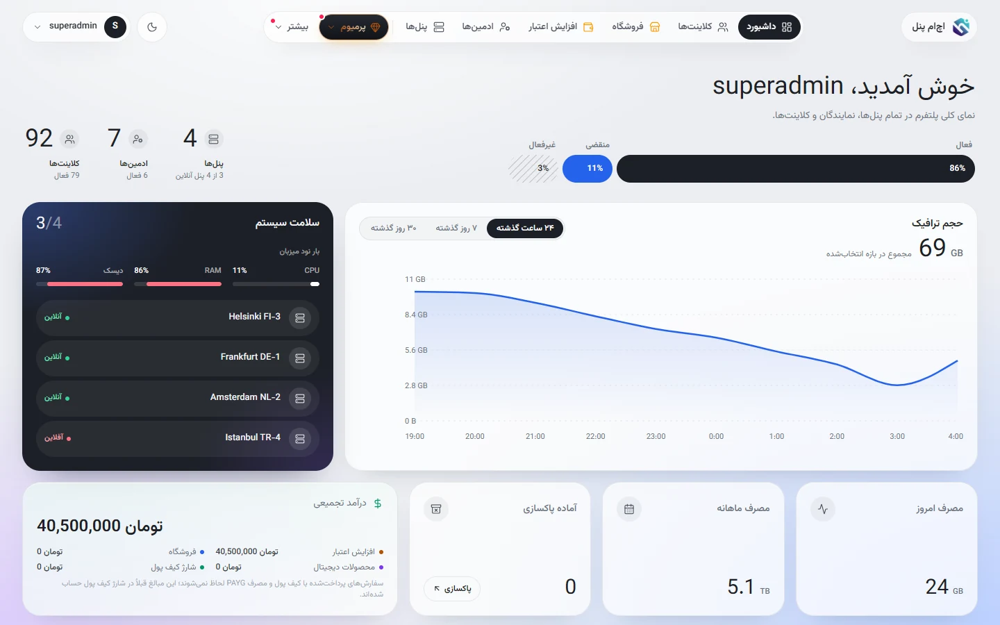
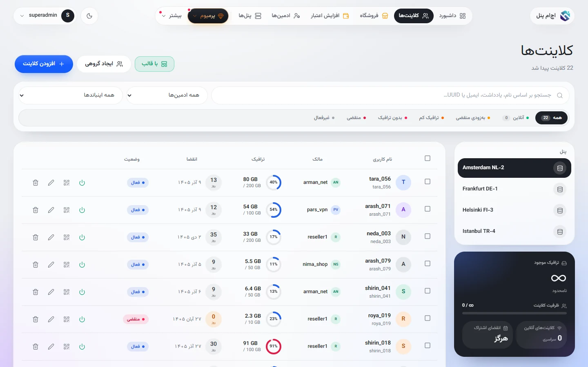
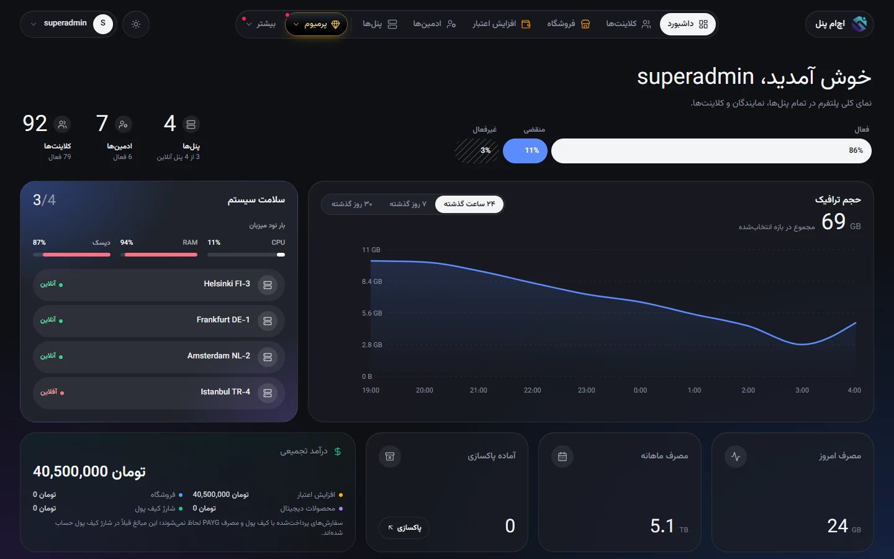

<!-- neo:header:start · generated by neoproject/brand/readme, edit config.json instead -->
<div align="center">


<h1>HMPanel</h1>

<p><b>پنل مدیریت حرفه‌ای 3x-ui برای نماینده‌ها و ارائه‌دهندگان VPN</b><br>
<sub>Advanced 3x-ui management platform for resellers and VPN providers</sub></p>

<p>
  <a href="https://github.com/neoauroraproject/hmpanel/releases/latest"></a>
  <a href="https://github.com/neoauroraproject/hmpanel/stargazers"></a>
  
  
</p>

<p>
  <a href="#-نصب"></a>
  <a href="https://neoauroraproject.github.io/hmpanel/fa/"></a>
  <a href="https://t.me/hmpanel"></a>
</p>

<p>
  <a href="https://hub.neoproject.dev"></a>
  <a href="https://t.me/neolicensebot"></a>
</p>

<p>
  <a href="https://neoproject.dev/hmpanel"></a>
</p>

<p><a href="#فارسی"><b>فارسی</b></a> &nbsp;·&nbsp; <a href="#english"><b>English</b></a></p>



</div>
<!-- neo:header:end -->

---

<h2 id="فارسی">فارسی</h2>

<div dir="rtl">

اچ‌ام‌پنل (HMPanel) یک **لایه مدیریت حرفه‌ای روی 3x-ui اصلی** است، برای ارائه‌دهندگان VPN، نماینده‌ها و ادمین‌هایی که چندین سرور و تعداد زیادی کاربر دارند.

### ✨ تازه‌های نسخه ۳.۰.۱

- **قوانین سرویس فروشگاه (پرمیوم):** نحوه تمدید (اضافه شدن به باقیمانده، شروع از نو، یا **رزرو** تا تمام شدن سرویس فعلی و شروع خودکار)، نام کاربری سرویس‌های جدید (از نام تلگرام، پیشوند + شماره، یا کد تصادفی؛ همیشه بدون تکرار)، **خرید حجم یا زمان اضافه** از ربات، **پلن دلخواه** با قیمت خودکار برای هر گیگ و روز، و **تیکت پشتیبانی** که ادمین با Reply در چت ادمین جواب می‌دهد (*فروشگاه ← تنظیمات ← قوانین سرویس*).
- **ربات (پرمیوم):** دکمه‌های **لیست قیمت** و **آموزش‌ها**، متن دلخواه صفحه پشتیبانی (مثلاً آیدی پشتیبان)، و پروکسی تلگرام با چسباندن لینک و تست مسیر مستقیم و پروکسی.
- **شارژ اضطراری (پرمیوم)** در صفحه ساب همه قالب‌ها، فقط برای سرویس‌های خریداری‌شده؛ شارژهای اخیر در تب جدای فروشگاه.
- **اتصال به پنل‌های ثنایی از طریق پروکسی:** اگر سرور مستقیم به 3x-ui وصل نشود، درخواست‌ها از پروکسی SOCKS5 یا HTTP می‌روند؛ «فقط وقتی مستقیم نشد» یا «همیشه» (*تنظیمات ← عمومی*).
- **ظرفیت هر پنل:** حداکثر تعداد کلاینت؛ پنل پر کلاینت جدید نمی‌سازد و در فروش جدید نمایش داده نمی‌شود، ولی تمدید کار می‌کند.
- **گروه‌ها** در خود پنل هم ذخیره می‌شوند و فیلتر گروه به لیست کلاینت‌ها اضافه شد؛ گروه 3x-ui هم همگام می‌شود.
- **پیام روی لینک ساب**، **جزئیات بازطراحی‌شده کلاینت** (مصرف، انقضا، لینک‌ها و QR) و پنجره «چه چیزی جدید است» برای مدیر اصلی بعد از هر آپدیت.
- **آپدیت خودکار پرمیوم:** بعد از `hm update`، اگر لایسنس فعال باشد باندل پرمیوم هم خودکار به‌روز می‌شود.

### ✨ تازه‌های نسخه ۳

- **ظاهر مدرن جدید.** داشبورد، کلاینت‌ها، ادمین‌ها، پنل‌ها، ترافیک و همه صفحه‌های پرمیوم چیدمان و نمودارهای تازه دارند. منوی بالا یا کناری، روشن و تاریک. از ۳.۰.۱ ظاهر جدید با منوی کناری پیش‌فرض است و ظاهر کلاسیک هر وقت بخواهید برمی‌گردد (*تنظیمات ← ظاهر* یا از منوی حساب).
- **منوی بالای شخصی.** انتخاب کنید کدام صفحه‌ها (تا ۷ تا) و به چه ترتیبی در منوی بالا باشند (*منوی حساب ← شخصی‌سازی منوی بالا*).
- **منوی جدای پرمیوم.** دکمه طلایی «پرمیوم» مگامنوی همه ماژول‌های پرمیوم را باز می‌کند. بدون لایسنس، ماژول‌ها قفل‌شده نمایش داده می‌شوند و لینک خرید دارند.
- **ادمین‌ها:** ساخت ادمین مرحله‌به‌مرحله (نوع حجم کلی یا جدا برای هر پنل همان اول)، پنجره شارژ سریع برای حجم هر پنل، ظرفیت کاربر و روز، و تنظیم دسترسی ماژول‌های پرمیوم از همان صفحه ادمین‌ها.
- **فروشگاه و ربات تلگرام (پرمیوم):** فقط یک پیام برای هر سفارش (بدون تکرار)، نمایش کد تخفیف روی سفارش، مدیریت جدید کدهای تخفیف، قیمت واضح‌تر و دکمه بازگشت در ربات، جستجوی سفارش و تنظیمات سریع برای ادمین.
- **محصولات دیجیتال (پرمیوم):** نمای کلی موجودی و فروش، هشدار کمبود موجودی و ساخت گروهی پک‌های تلگرام استارز از روی قیمت ۱۰۰ استارز.
- **پرداخت به‌ازای مصرف (پرمیوم):** داشبورد جدید؛ مشتری می‌تواند سرویسش را از ربات حذف کند (از پنل هم پاک می‌شود)؛ با تمام شدن موجودی سرویس فقط غیرفعال می‌شود.
- **فروش نمایندگی (پرمیوم):** چک‌لیست راه‌اندازی و پیش‌نمایش پیشنهاد، و رفع مشکل شارژ نمایندگان با حجم جدا برای هر پنل.
- **حذف کامل و تمیز:** حذف پنل حالا همه چیزهایی که نصب کرده را پاک می‌کند و نصب دوباره بدون خطا انجام می‌شود.

فهرست کامل: [CHANGELOG.md](CHANGELOG.md)

### 📸 تصاویر

<table>
  <tr>
    <td width="50%" align="center"><br><sub><b>منوی پرمیوم</b></sub></td>
    <td width="50%" align="center"><br><sub><b>کلاینت‌ها</b></sub></td>
  </tr>
  <tr>
    <td width="50%" align="center"><br><sub><b>ادمین‌ها</b></sub></td>
    <td width="50%" align="center"><br><sub><b>محصولات دیجیتال</b></sub></td>
  </tr>
  <tr>
    <td width="50%" align="center"><br><sub><b>پرداخت به‌ازای مصرف</b></sub></td>
    <td width="50%" align="center"><br><sub><b>حالت تاریک</b></sub></td>
  </tr>
  <tr>
    <td width="50%" align="center"><br><sub><b>پیش‌نمایش پرمیوم بدون لایسنس</b></sub></td>
    <td width="50%" align="center"><br><sub><b>شخصی‌سازی منوی بالا</b></sub></td>
  </tr>
</table>

### ⚡ امکانات

**نسخه رایگان (Community)**
- **مدیریت چند پنل و نماینده:** کنترل چندین سرور 3x-ui، نماینده‌ها با محدودیت حجم، تعداد کاربر و زمان؛ حجم کلی یا جدا برای هر پنل.
- **حسابداری ترافیک:** محاسبه لحظه‌ای، حالت مصرفی و تخصیصی، مهلت قطع و لاگ امن استرداد.
- **یکپارچگی با 3x-ui:** اتصال کلاینت‌ها به گروه‌های اصلی 3x-ui و یک کلاینت روی چند اینباند. پشتیبانی تا نسخه 3.11.
- **گروه‌بندی و ظرفیت:** گروه کلاینت‌ها با فیلتر، و سقف تعداد کلاینت برای هر پنل.
- **عملیات گروهی روی ادمین‌ها:** فعال/غیرفعال، افزودن حجم، روز و ظرفیت، و دادن یا گرفتن دسترسی اینباند برای چند ادمین با هم.
- **تاریخچه ترافیک و لاگ عملیات** که حجم، مصرف و انقضای سرویس‌های حذف‌شده را هم نگه می‌دارد.
- **اتصال از طریق پروکسی** به پنل‌هایی که مستقیم در دسترس نیستند (SOCKS5 یا HTTP).
- **عملیات گروهی و مهاجرت:** ساخت، ویرایش، تمدید و حذف گروهی؛ مهاجرت از پنل‌های قدیمی.
- **پشتیبان‌گیری:** دانلود، آپلود و بازگردانی بکاپ از پنل یا دستور `hm`.
- **ظاهر مدرن یا کلاسیک**، فارسی و انگلیسی، روشن و تاریک، قابل نصب به‌صورت اپ (PWA).

**نسخه پرمیوم**
- **فروشگاه و ربات تلگرام:** فروش پلن با ربات و مینی‌اپ، رسید، کد تخفیف، باشگاه مشتریان، دعوت دوستان و تحویل خودکار.
- **قوانین سرویس:** تمدید افزایشی، از نو یا رزروی؛ نام‌گذاری خودکار سرویس‌ها؛ فروش حجم و زمان اضافه؛ پلن دلخواه؛ تیکت پشتیبانی؛ لیست قیمت و آموزش‌ها در ربات؛ شارژ اضطراری.
- **محصولات دیجیتال** با موجودی کد رمزگذاری‌شده و تحویل خودکار یا دستی؛ **پرداخت به‌ازای مصرف** از کیف پول مشتری.
- **پرداخت:** کارت بانکی، کیف پول کریپتو، درگاه آنلاین و تلگرام استارز.
- **فروش نمایندگی:** فروش حساب نمایندگی و شارژ نمایندگان از اول تا آخر.
- **پنل پلاس** (Eylan و Pasarguard)، قالب کلاینت، کمپین بازاریابی، برندینگ، قالب صفحه اشتراک، دامنه اختصاصی، مانیتورینگ و مرکز پشتیبان.

خرید پرمیوم: [license.hmray.pro](https://license.hmray.pro) یا ربات [@neolicensebot](https://t.me/neolicensebot). لایسنس را در *تنظیمات ← لایسنس پرمیوم* وارد کنید.

<a id="نصب"></a>

### 🚀 نصب

دستور زیر را در یک سرور اوبونتو (24.04+) یا دبیان تازه وارد کنید:

</div>

```bash
bash <(curl -fsSL https://raw.githubusercontent.com/neoauroraproject/hmpanel/main/install.sh)
```

<div dir="rtl">

*(پیش‌نیازها: آی‌پی پابلیک مستقیم برای SSL، حداقل ۱ گیگ رم و ۵ گیگ فضا)*

### 🔄 به‌روزرسانی

نصب‌های قبلی بدون نصب دوباره و بدون از دست رفتن اطلاعات به‌روز می‌شوند:

</div>

```bash
sudo hm update
```

<div dir="rtl">

یا `sudo hm` را بزنید و گزینه **Update** را انتخاب کنید. اگر لایسنس پرمیوم فعال باشد، باندل پرمیوم هم بعد از آپدیت پنل خودکار به‌روز می‌شود و نتیجه در پایان آپدیت نمایش داده می‌شود. در صورت نیاز می‌توانید از *تنظیمات ← لایسنس پرمیوم* دکمه **به‌روزرسانی باندل پرمیوم** را دستی بزنید.

### 💾 بکاپ و بازگردانی
- **از پنل:** *تنظیمات ← نگهداری سیستم* برای دانلود، آپلود یا بازگردانی بکاپ با یک کلیک.
- **از ترمینال:** دستور `sudo hm` و گزینه‌های بکاپ.

### 🗑️ حذف پنل

`sudo hm` را بزنید و **Uninstall** را انتخاب کنید، یا مستقیم:

</div>

```bash
sudo bash /opt/hmpanel/uninstall.sh --standard   # حذف برنامه، نگه‌داشتن دیتابیس، فایل‌ها، بکاپ‌ها و .env
sudo bash /opt/hmpanel/uninstall.sh --complete   # حذف همه چیز (باید DELETE را تایپ کنید)
```

<div dir="rtl">

هر دو حالت کانتینرها، سرویس systemd، دستور `hm` و فایل‌های موقت باقی‌مانده را پاک می‌کنند تا نصب بعدی تمیز انجام شود. بعد از حذف استاندارد، با اجرای دوباره نصب‌کننده اطلاعاتتان برمی‌گردد؛ سپس پرمیوم را دوباره فعال کنید.

### 🔑 ریست رمز ادمین اصلی
اگر رمز ادمین اصلی (owner / SUPER_ADMIN) را فراموش کردید، روی سرور این دستور را بزنید:

</div>

```bash
bash <(curl -fsSL https://raw.githubusercontent.com/neoauroraproject/hmpanel/main/scripts/reset-admin-password.sh)
```

<div dir="rtl">

یا بعد از نصب/آپدیت: `sudo hm admin reset-password` · `sudo hm passwd` · گزینه **۱۳** منوی `hm`.

**نام کاربری** ادمین اصلی را هم فراموش کرده‌اید؟ دستور `sudo hm admin reset-login` (یا `sudo hm reset-login` یا گزینه **۱۴** منوی `hm`) نام کاربری فعلی ادمین اصلی را نشان می‌دهد و اجازه می‌دهد نام کاربری، رمز یا هر دو را عوض کنید (با Enter هر کدام بدون تغییر می‌ماند). رمز به‌صورت مخفی و دو بار پرسیده می‌شود (حداقل ۸ کاراکتر)، نام کاربری تکراری پذیرفته نمی‌شود و همه‌ی نشست‌های فعلی ادمین اصلی از حساب خارج می‌شوند. فهرست کامل دستورها: `sudo hm help`.

</div>

---

<h2 id="english">English</h2>

HMPanel is a **professional management layer built on top of native 3x-ui**, for VPN providers, resellers and administrators who run many servers and a large number of clients.

### ✨ What's new in v3.0.1

- **Store service rules (Premium):** how renewals apply (add to what is left, start fresh, or **reserve** until the current service runs out and then start automatically), names for new services (Telegram name, prefix + number, or random code; always unique), **extra volume or time** from the bot, a **custom plan** priced per GB and day, and **support tickets** answered by replying in the admin chat (*Store → Settings → Service rules*).
- **Bot (Premium):** **Price list** and **Tutorials** buttons, your own support page text (e.g. the support account), and a Telegram proxy you can paste as a link and test against the direct route.
- **Emergency recharge (Premium)** on the subscription page in every theme, for purchased services only; recent recharges have their own Store tab.
- **Reach 3x-ui panels through a proxy:** when this server cannot connect to a panel directly, requests go through a SOCKS5 or HTTP proxy, only when direct fails or always (*Settings → General*).
- **Panel capacity:** a maximum number of clients per panel; a full panel takes no new clients and is left out of new sales, while renewals keep working.
- **Groups** are also stored in the panel, with a group filter on the client list; the 3x-ui group still syncs.
- **Subscription message**, **redesigned client details** (usage, expiry, links and QR) and a one-time "What's new" window for the main admin after each update.
- **Premium auto-update:** after `hm update`, an active license also updates the Premium bundle.

### ✨ What's new in v3

- **New modern look.** Dashboard, clients, admins, panels, traffic and every Premium page have new layouts and charts. Top bar or sidebar navigation, light and dark. Since 3.0.1 the new look with the side menu is the default; the classic look can be switched back at any time (*Settings → Appearance*, or from the account menu).
- **Your own top menu.** Pick which pages (up to 7) sit in the top bar and in what order (*account menu → Customize top menu*).
- **Dedicated Premium menu.** A gold Premium button opens a mega menu of every Premium module. Without a license the modules are shown locked, with links to buy.
- **Admins:** step-by-step admin creation (shared or per-panel traffic is chosen first), a quick top-up dialog for per-panel GB, client capacity and days, and Premium module access set on the Admins page.
- **Store and Telegram bot (Premium):** one admin message per order (no more duplicates), coupon shown on orders, a redesigned coupon manager, clearer prices and back buttons in the bot, order search and quick settings for admins.
- **Digital goods (Premium):** stock and sales overview, low-stock alerts, and bulk creation of Telegram Stars packs from the price of 100 stars.
- **Pay as you go (Premium):** new dashboard, customers can delete their own service from the bot (it is removed from the panel too), an empty wallet only disables the service.
- **Reseller sales (Premium):** a setup checklist and offer preview, and fixes for per-panel reseller top-ups.
- **Clean uninstall:** removing the panel now deletes everything it installed, so a reinstall works without errors.

Full list: [CHANGELOG.md](CHANGELOG.md).

### 📸 Screenshots

<table>
  <tr>
    <td width="50%" align="center"><br><sub><b>Premium menu</b></sub></td>
    <td width="50%" align="center"><br><sub><b>Clients</b></sub></td>
  </tr>
  <tr>
    <td width="50%" align="center"><br><sub><b>Admins</b></sub></td>
    <td width="50%" align="center"><br><sub><b>Digital goods</b></sub></td>
  </tr>
  <tr>
    <td width="50%" align="center"><br><sub><b>Pay as you go</b></sub></td>
    <td width="50%" align="center"><br><sub><b>Dark mode</b></sub></td>
  </tr>
  <tr>
    <td width="50%" align="center"><br><sub><b>Premium preview without a license</b></sub></td>
    <td width="50%" align="center"><br><sub><b>Customize the top menu</b></sub></td>
  </tr>
</table>

### ⚡ Features

**Community (free)**
- **Multi-panel & reseller management:** control many 3x-ui nodes, resellers with their own traffic, client and expiry limits, shared or per-panel traffic.
- **Traffic accounting:** real-time collection, usage-based and allocation-based modes, grace periods and an audited refund log.
- **Native 3x-ui integration:** clients map to native 3x-ui groups; one client can sit on several inbounds. Supports 3x-ui up to 3.11.
- **Groups and capacity:** client groups with a filter, and a client cap per panel.
- **Bulk actions on admins:** enable or disable, add traffic, days and capacity, and grant or revoke inbounds for many admins at once.
- **Traffic history and action log** that keeps the volume, usage and expiry of deleted services.
- **Proxy connection** to panels that cannot be reached directly (SOCKS5 or HTTP).
- **Bulk operations & migration:** bulk create, edit, extend and delete; migration from older panels.
- **Backups:** download, upload and restore PostgreSQL backups from the web UI or the `hm` CLI.
- **Modern or classic UI**, Persian and English, light and dark, installable as an app (PWA).

**Premium**
- **Store & Telegram bot:** sell plans with a bot and mini app, receipts, coupons, loyalty, referrals and auto delivery.
- **Service rules:** additive, fresh or reserved renewals; automatic service names; extra volume and time; custom plans; support tickets; price list and tutorials in the bot; emergency recharge.
- **Digital goods** with encrypted code stock and automatic or manual delivery; **pay-as-you-go** services billed from the customer wallet.
- **Payments:** bank cards, crypto wallets, online gateways and Telegram Stars.
- **Reseller sales:** sell reseller accounts and reseller top-ups end to end.
- **Panel Plus** (Eylan, Pasarguard), client templates, marketing campaigns, branding, themes, custom domains, monitoring and a backup center.

Buy Premium: [license.hmray.pro](https://license.hmray.pro) or [@neolicensebot](https://t.me/neolicensebot). Enter the license in *Settings → Premium License*.

<a id="install"></a>

### 🚀 Installation

Run on a fresh Ubuntu (24.04+) or Debian server:
```bash
bash <(curl -fsSL https://raw.githubusercontent.com/neoauroraproject/hmpanel/main/install.sh)
```
*(Requires: direct public IP for Let's Encrypt SSL, 1 GB RAM, 5 GB disk)*

### 🔄 Update

Existing installs update in place; no reinstall is needed and data is kept:
```bash
sudo hm update
```
Or open `sudo hm` and choose **Update**. With an active Premium license, the Premium bundle also updates automatically after the panel update, and the result is shown at the end. You can still press **Update premium bundle** in *Settings → Premium License* by hand if needed.

### 💾 Backup & Restore
- **Web UI:** *Settings → System Maintenance* to download, upload or restore backups with one click.
- **CLI:** run `sudo hm` and choose the backup options.

### 🗑️ Uninstall

Run `sudo hm` and choose **Uninstall**, or call the script directly:
```bash
sudo bash /opt/hmpanel/uninstall.sh --standard   # remove the app, keep database, uploads, backups and .env
sudo bash /opt/hmpanel/uninstall.sh --complete   # remove everything (asks you to type DELETE)
```
Both remove the containers, the systemd service, the `hm` command and leftover temp files, so a later reinstall starts clean. After a standard uninstall, run the installer again to come back with your data, then re-activate Premium.

### 🔑 Reset Main Admin Password
Forgot the owner / SUPER_ADMIN password? Reset it from the server (interactive prompt):
```bash
bash <(curl -fsSL https://raw.githubusercontent.com/neoauroraproject/hmpanel/main/scripts/reset-admin-password.sh)
```
Or via CLI after install/update: `sudo hm admin reset-password` · `sudo hm passwd` · menu option **13**.

Forgot the owner **username** too? `sudo hm admin reset-login` (or `sudo hm reset-login`, menu option **14**) shows the current owner username, then lets you change the username, the password, or both (press Enter to keep either one). The password is typed hidden and asked twice (min 8 characters); a username another admin already uses is rejected, and all existing sessions of the owner are signed out. Run `sudo hm help` for the full command list.

<!-- neo:footer:start · generated by neoproject/brand/readme, edit config.json instead -->
<br>
<div align="center">

<a href="https://neoproject.dev"></a>

<h3><a href="https://neoproject.dev">neoproject.dev</a></h3>

<p><b>HMPanel</b> is part of <b>NeoProject</b>: tools, panels and apps built for people who run their own servers and services.</p>
<p dir="rtl"><sub>HMPanel یکی از محصولات NeoProject است؛ مجموعه‌ای از ابزارها، پنل‌ها و اپ‌های کاربردی.</sub></p>

<table>
<tr><th>Channels</th><th>Support</th><th>Donate</th></tr>
<tr>
<td valign="top">
<a href="https://t.me/neoaurora"><b>@neoaurora</b></a><br><sub>News and releases</sub><br><br>
<a href="https://t.me/hmpanel"><b>@hmpanel</b></a><br><sub>HMPanel community</sub><br><br>
<a href="https://t.me/neotunnels"><b>@neotunnels</b></a><br><sub>NeoTunnel community</sub>
</td>
<td valign="top">
<a href="https://t.me/hmraysupport"><b>@hmraysupport</b></a><br><sub>Sales and licenses</sub><br><br>
<a href="https://t.me/neolicensebot"><b>@neolicensebot</b></a><br><sub>Trial, renewal, Stars</sub>
</td>
<td valign="top" align="center">
<a href="https://neoproject.dev/donate"></a><br><sub>USDT · TON · TRON · Telegram Stars</sub>
</td>
</tr>
</table>

<p><sub><b>More from NeoProject</b></sub><br>
<a href="https://github.com/neoauroraproject/neotunnel">NeoTunnel</a> · <a href="https://github.com/neoauroraproject/Neo-Uptime">NeoUptime</a> · <a href="https://github.com/neoauroraproject/neoexit">NeoExit</a> · <a href="https://github.com/neoauroraproject/neopaste">NeoPaste</a> · <a href="https://github.com/neoauroraproject/NeoTemplate">NeoTemplate</a> · <a href="https://github.com/neoauroraproject/NeoConfig">NeoConfig</a> · <a href="https://github.com/neoauroraproject/neocheck">NeoCheck</a> · <a href="https://github.com/neoauroraproject/3xfactor">3xFactor</a> · <a href="https://neoproject.dev/projects"><b>All projects</b></a></p>

<p>⭐ If HMPanel is useful to you, give it a star.</p>

<sub>© 2026 NeoProject · <a href="https://github.com/neoauroraproject">GitHub</a> · <a href="https://neoproject.dev">neoproject.dev</a></sub>

</div>
<!-- neo:footer:end -->
