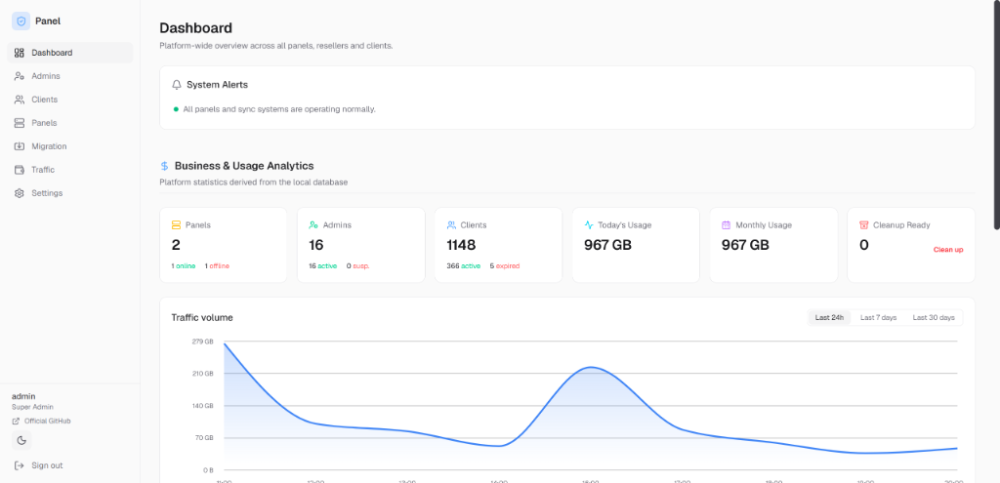
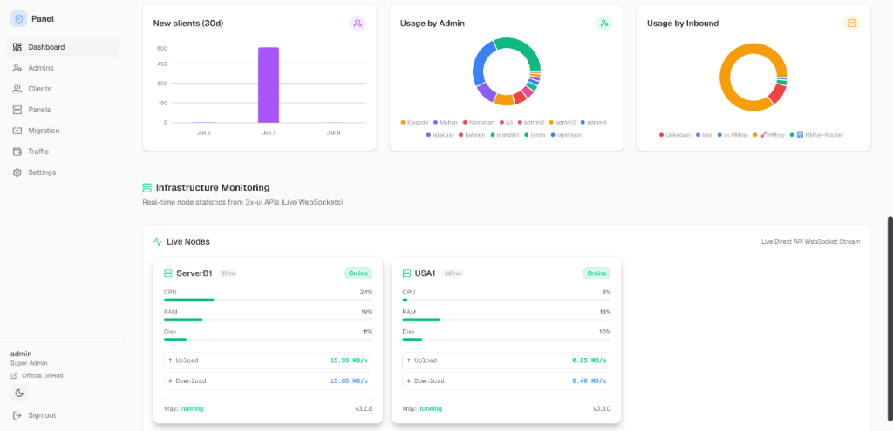
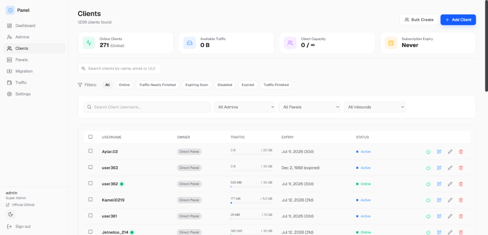

<div align="center">

# HMPanel
**Advanced 3x-ui Management Platform**


[English](#english) | [فارسی](#فارسی)

**Docs:** [neoauroraproject.github.io/hmpanel](https://neoauroraproject.github.io/hmpanel/) · Channel: [t.me/hmpanel](https://t.me/hmpanel) · Premium License: [t.me/hmraysupport](https://t.me/hmraysupport)

</div>

---

<h2 id="english">🇬🇧 English</h2>

HMPanel is a **professional management layer built specifically on top of native 3x-ui**. Designed for VPN Providers, Resellers, and Administrators managing large client bases across multi-panel deployments.

### 📚 Documentation

Documentation for Community and Premium editions: [https://neoauroraproject.github.io/hmpanel/](https://neoauroraproject.github.io/hmpanel/)

### 🚀 Installation

Execute the following on a fresh Ubuntu (24.04+) or Debian server:
```bash
bash <(curl -fsSL https://raw.githubusercontent.com/neoauroraproject/hmpanel/main/install.sh)
```
*(Requires: Direct public IP for Let's Encrypt SSL, 1GB RAM, 5GB Disk)*


<summary><b>📸 Screenshots</b></summary>

### Super Admin Dashboard


### Infrastructure Monitoring


### Client Management



### ⚡ Key Features
- **Multi-Panel & Reseller Management:** Control multiple 3x-ui nodes, manage resellers with multi-tier permissions, and set traffic/client limits.
- **Advanced Traffic Accounting:** Real-time collection, automated grace periods, usage-based & allocation-based modes, and secure refund auditing.
- **Native 3x-ui Integration:** Cleanly maps clients to native 3x-ui groups. Attach one client to multiple inbounds seamlessly.
- **Automated Backup System:** Download, upload, and restore PostgreSQL database backups directly from the Web UI.
- **Bulk Operations & Migration Engine:** Efficiently manage clients in bulk and migrate easily from legacy panels (e.g., WhalePanel).

### 💾 Backup & Restore
- **Web UI (New!):** Go to *Settings > System Maintenance* to download, upload, or restore backups with one click.
- **CLI Manager:** Run `sudo hm` to create or restore backups safely via the terminal.

### 🔑 Reset Main Admin Password
Forgot the owner / SUPER_ADMIN password? Reset it from the server (interactive prompt):
```bash
bash <(curl -fsSL https://raw.githubusercontent.com/neoauroraproject/hmpanel/main/scripts/reset-admin-password.sh)
```
Or via CLI after install/update: `sudo hm admin reset-password` · `sudo hm passwd` · menu option **13**.

Forgot the owner **username** too? `sudo hm admin reset-login` (or `sudo hm reset-login`, menu option **14**) shows the current owner username, then lets you change the username, the password, or both (press Enter to keep either one). The password is typed hidden and asked twice (min 8 characters); a username another admin already uses is rejected, and all existing sessions of the owner are signed out. Run `sudo hm help` for the full command list.

---

<h2 id="فارسی">🇮🇷 فارسی</h2>

اچ‌ام‌پنل (HMPanel) یک **لایه مدیریت حرفه‌ای و پیشرفته برای پنل‌های 3x-ui** است که منحصراً برای ارائه‌دهندگان VPN و ادمین‌هایی که چندین سرور و تعداد زیادی کاربر دارند طراحی شده است.

### 📚 مستندات

مستندات نسخهٔ Community و Premium: [https://neoauroraproject.github.io/hmpanel/fa/](https://neoauroraproject.github.io/hmpanel/fa/)

کانال تلگرام: [t.me/hmpanel](https://t.me/hmpanel) · خرید لایسنس نسخه پرمیوم: [t.me/hmraysupport](https://t.me/hmraysupport)

### 🚀 نصب و راه‌اندازی

دستور زیر را در یک سرور اوبونتو (20.04+) یا دبیان جدید و خام وارد کنید:
```bash
bash <(curl -fsSL https://raw.githubusercontent.com/neoauroraproject/hmpanel/main/install.sh)
```
*(پیش‌نیازها: آی‌پی پابلیک مستقیم برای دریافت SSL، حداقل 1 گیگابایت رم، 5 گیگابایت فضای ذخیره‌سازی)*

<details>
<summary><b>📸 تصاویر پنل (برای مشاهده کلیک کنید)</b></summary>

### داشبورد سوپر ادمین


### مانیتورینگ زیرساخت


### مدیریت کاربران


</details>

### ⚡ ویژگی‌های کلیدی
- **مدیریت چند پنل و ریسلرها:** کنترل چندین پنل 3x-ui به‌صورت همزمان، تعریف ریسلر با سطوح دسترسی مختلف، همراه با محدودیت ترافیک و تعداد کاربر.
- **حسابداری پیشرفته ترافیک:** محاسبه لحظه‌ای، اعمال قطعی خودکار، حالت‌های مصرفی/تخصیصی، و سیستم امن لاگ و استرداد (Refund Audit) برای جلوگیری از باگ‌های مالی.
- **یکپارچگی با گروه‌های 3x-ui:** تخصیص کاربران به گروه‌های نیتیو و اتصال یک کلاینت به چندین کانفیگ (Inbound) بدون قطعی.
- **سیستم بکاپ‌گیری خودکار:** امکان دانلود، آپلود، و ری‌استور دیتابیس مستقیماً از طریق رابط کاربری (Web UI).
- **عملیات گروهی و مهاجرت آسان:** ابزار حرفه‌ای برای ویرایش و حذف گروهی، به همراه موتور مهاجرت (Migration) قدرتمند از پنل‌های قدیمی (مانند WhalePanel).

### 💾 بکاپ و بازگردانی
- **از طریق پنل کاربری (جدید):** با مراجعه به بخش *تنظیمات > نگهداری سیستم* به راحتی بکاپ‌ها را دانلود، آپلود یا بازگردانی کنید.
- **از طریق ترمینال (CLI):** دستور `sudo hm` را وارد کنید تا به منوی مدیریت سرور و بخش بکاپ دسترسی داشته باشید.

### 🔑 ریست رمز ادمین اصلی
اگر رمز ادمین اصلی (owner / SUPER_ADMIN) را فراموش کردید، روی سرور این دستور تک‌خطی را بزنید:
```bash
bash <(curl -fsSL https://raw.githubusercontent.com/neoauroraproject/hmpanel/main/scripts/reset-admin-password.sh)
```
یا بعد از نصب/آپدیت: `sudo hm admin reset-password` · `sudo hm passwd` · گزینه **۱۳** منوی `hm`.

**نام کاربری** ادمین اصلی را هم فراموش کرده‌اید؟ دستور `sudo hm admin reset-login` (یا `sudo hm reset-login` یا گزینه **۱۴** منوی `hm`) نام کاربری فعلی ادمین اصلی را نشان می‌دهد و اجازه می‌دهد نام کاربری، رمز یا هر دو را عوض کنید (با Enter هر کدام بدون تغییر می‌ماند). رمز به‌صورت مخفی و دو بار پرسیده می‌شود (حداقل ۸ کاراکتر)، نام کاربری تکراری پذیرفته نمی‌شود و همه‌ی نشست‌های فعلی ادمین اصلی از حساب خارج می‌شوند. فهرست کامل دستورها: `sudo hm help`.

---

<div align="center">

---

### 🌌 NEO AURORA

<p>
  <a href="https://t.me/neoaurora">Telegram</a> &nbsp;·&nbsp;
  <a href="https://t.me/hmraysupport">Support</a> &nbsp;·&nbsp;
  <a href="https://t.me/neolicensebot">License Bot</a> &nbsp;·&nbsp;
  <a href="https://github.com/neoauroraproject">GitHub</a>
</p>

<p>
  <a href="https://t.me/hmpanel">HMPanel Community</a>
  &nbsp;·&nbsp;
  <a href="https://t.me/neotunnels">NeoTunnel Community</a>
  &nbsp;·&nbsp;
  <a href="https://github.com/neoauroraproject?tab=repositories">All Projects</a>
</p>

<br>

### 💖 Support Our Development

<p>
  Your support helps us maintain and improve our open-source projects.
</p>

<p>
  <a href="https://bscscan.com/address/0x94efb6642b8fcc591c28a8c04db2279908f66e18">
    
  </a>
  <br>
  <code>0x94efb6642b8fcc591c28a8c04db2279908f66e18</code>
</p>

<p>
  <a href="https://tonscan.org/address/UQD6NpICg2Q7nF_yFRrKW2_ZgB5LPI1X2KDK0JDjlivwhCJ5">
    
  </a>
  <br>
  <code>UQD6NpICg2Q7nF_yFRrKW2_ZgB5LPI1X2KDK0JDjlivwhCJ5</code>
</p>

<p>
  <a href="https://tronscan.org/#/address/TJsBskCPtbVk6gKxTkcocjJX2qNa62Mo1X">
    
  </a>
  <br>
  <code>TJsBskCPtbVk6gKxTkcocjJX2qNa62Mo1X</code>
</p>

<br>

⭐ **Enjoying this project? Give it a star!**

<p>
  Every star helps us grow and reach more developers.
</p>

**Crafted with ❤️ by the NeoAurora Team**

<sub>Open Source · Built with Passion</sub>

---

</div>
